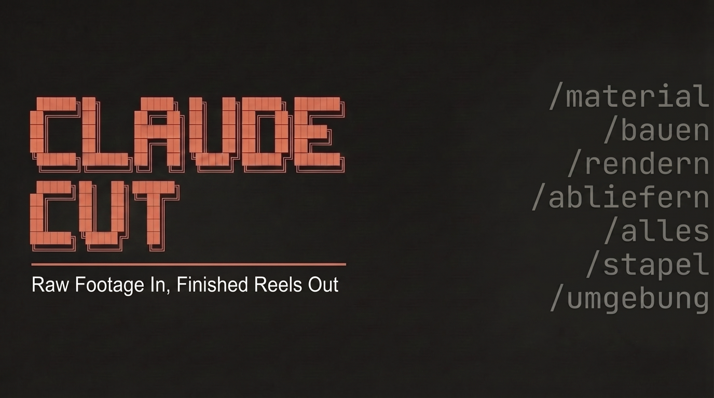

<p align="center">
  
</p>

<h3 align="center">One raw recording in. A finished reel pair out, checked to the frame and the millisecond.</h3>

<p align="center">
  <a href="#the-gates"></a>
  <a href="#every-failure-becomes-a-gate"></a>
  <a href="#regression"></a>
  <a href="#hooks"></a>
  
</p>

---

A talking-head reel looks simple. Cut the pauses, add captions, put a card on the key
sentence, done. Then the creator watches it on her phone and finds what the editor did not:
a word that starts two frames after its caption, a click on a cut, a card that covers her
eyes, a hook that begins in the middle of a sentence.

Every one of those is measurable. This skill measures them before anyone else sees the reel.

Give it a creator's raw iPhone footage and a short plan. It picks the story order, edits on
measured silences, aligns every caption to the audible start of its word, builds animated
explainer cards in the channel's brand, mixes card sounds and masters to -14 LUFS. It
delivers two versions, **with and without a comment keyword**, plus a cover with a text hook.
The machine does about 95 % of the job. The last 5 % stay human: the eye for "premium" and
the decision what gets posted.

## Quick start

You need a Mac with Apple silicon, about 20 GB of free disk space and
[Claude Code](https://claude.com/claude-code). No prior knowledge: Claude reads the skill and does the steps, you answer and look.

1. **Install the skill**
   ```bash
   git clone https://github.com/nicojunk/claude-cut.git
   cp -r claude-cut/skill ~/.claude/skills/smm-clipping
   ```
2. **Check the machine.** In Claude Code say *"Prüfe die Umgebung für SMM Clipping"*, or run
   `python3 ~/.claude/skills/smm-clipping/scripts/clip.py umgebung`. It lists every missing tool or model with its install
   command. Install and run it again until it prints `UMGEBUNG VOLLSTÄNDIG`.
3. **Settings.** Copy `skill/kanaele/config-vorlage.json` to `~/.config/smm-clipping/config.json`. Keep the render folder
   outside iCloud (`~/Renders`).
4. **Set up your channel once (about 15 minutes).** Say *"Richte einen neuen Kanal ein: Name, Thema, Kommentarwort"* and give
   Claude your brand colours and fonts, or one finished reel as a reference. Claude fills the profile from
   `skill/kanaele/vorlage.json` and checks the contrast rules (`kanal.py pruefen`). You decide the call to action and the
   words the creator must never say on camera.
5. **Make a reel.** Put the raw iPhone recordings in the folder named in the profile and say *"Mach aus IMG_1234.MOV ein
   Reel zum Thema …, Kommentarwort …"*. Claude transcribes, picks the hook from the 50 templates, builds both versions, runs
   every gate and puts the finished files on the desktop.
6. **Look** at `vorschau-handy.mp4` on your phone. Posting is your decision; the skill never posts or sends anything.

**Same quality for everyone.** The result does not depend on how well you prompt: every step that decides quality is a
script with an exit code (the gates below). If one fails, the build stops and says what to fix. What differs between
channels is only what the profile gives: colours, fonts, call to action and the explainer cards. This public version
ships the generic cards; cards for one channel are built per channel (`skill/references/card-catalog.md`).

---

## What you get

| Output | Details |
|---|---|
| `…-mit-kommentarwort.mp4` | 1080 x 1920, 30 fps, H.264 without B-frames, ends on the comment keyword card |
| `…-ohne-kommentarwort.mp4` | same reel with the channel's other call to action |
| `…-cover.jpg` | cover in the channel's colours, text hook from 50 templates, also frame 0 of both videos |
| `vorschau-handy.mp4` | small copy for review on the phone |
| `abgabe.txt` | every check with its measured value |

Picture starts at 0.000 s in every file. Audio is -14 LUFS with true peak below -1.5 dBTP,
measured on the delivered file, not on the master.

## Time per reel

Measured on a MacBook Pro with Apple M5 Pro:

| | One reel | Reel pair (with and without keyword) |
|---|---|---|
| From the request to the finished files (17.10.2026) | 51 min | 83 min |
| Machine time of the current version (18.10.2026) | 15 min | 38 min |

The difference is Claude reading the material and choosing hook, pieces and cards. Transcribing new raw material comes
on top (once per recording).

## How it works

```
material  ->  bauen  ->  rendern  ->  pruefen  ->  abliefern
```

| Phase | What happens |
|---|---|
| `material` | iPhone HDR to SDR with Apple's tonemapper, raw-take check, transcript with word times, stop-word scan per clip |
| `bauen` | hook and pieces from the plan, seams in measured pauses, Whisper per piece, forced alignment, audible-onset correction, pause gating, cards, captions, composition |
| `rendern` | HyperFrames render, mastering, one AAC encode from the uncompressed master |
| `pruefen` | frame count, audio packets, true peak, black start, flicker, zoom jumps, cards over the face, caption timing on the finished audio |
| `abliefern` | cover as frame 0, audio copied bit-identical from the checked file, copies with md5 |

`alles` runs all phases for both versions. `stapel` runs a list of topics after one approval.

## The gates

Every gate is a script with an exit code. A failed gate stops the build; nothing is sent
anywhere on its own.

| Step | Gate | Stops when |
|---|---|---|
| selection | `plan_bauen.py auswahl` | a hook starts mid-sentence, a seam lies in a sound or a breath, a compliance stop word is in the material |
| words | `hook_ende.py` | the last word of the hook is cut (raw-clip envelope and context-free Whisper) |
| pre-render | `schnitte_vorab.py` | a cut is not in silence, a caption is shown later than its word, a card sound is audible over a word end, a mask clips text |
| pre-render | `pruefe_dramaturgie.py` | under 300 ms between the hook's last sound and the first visible frame of the change, no benefit by second 15 |
| delivery | `pruefe_ton_spitze.py` | true peak above -1.5 dBTP or a one-sided click at the start |
| delivery | `pruefe_schwarz.py` | the picture does not start at 0.000 s, first or last frame black |
| delivery | `eigenpruefung.py` | zoom jumps, white captions inside a flash, empty cards, a card over eyes or brows |
| delivery | `pruefe_ms.py` | wording differs from the finished audio near a cut, captions early against the aligned start |

The full table with all 17 gates is in [`skill/references/quality-gates.md`](skill/references/quality-gates.md).

## Independent inspection

The gates were not written from a checklist. Each validation reel goes to an inspector agent
that never reads the tool's code or its reports and writes its own measurement code from
scratch. Whatever it finds that the gates missed becomes a new gate, and the new gate must
fail on the old build before the fix is accepted.

Examples of what got caught this way, all now blocked by a script:

| Found by the inspector | Why the own checks missed it | Gate now |
|---|---|---|
| first word after a flash shown 139 to 201 ms late | the check measured the planned time, the renderer held the word back | shown caption times from the composition |
| click of +0.39 dBTP in the first frame, left channel only | the master was measured before the AAC encoder added it | true peak on the delivered file |
| card sound on the fading end of a word, deep male voice | a bright voice had masked the same placement | treble of the click against the voice |
| keyword card over the eyes | the face box shifts when a card covers the forehead | eye and brow landmarks |
| last word of the hook cut to its first consonant | the trim read a stop closure as "word over" | hook end is never moved earlier |

## Every failure becomes a gate

[`skill/references/pitfalls.md`](skill/references/pitfalls.md) records 99 failures with the
measured values, the cause and the fix. The rule behind it: a rule that only exists as text
will be ignored at some point. A script with an exit code will not.

## Regression

Eight reels that were delivered to a real creator are rebuilt after every engine change. The
composition (`index.html`) and the edit list (`edl.json`) must come out byte-identical, or
the change is logged as intended and reviewed.

## Hooks

[`skill/references/hook-vorlagen.md`](skill/references/hook-vorlagen.md) holds 50 German hook
templates in 7 mechanisms (curiosity, shortcut, myth, address, self-test, authority, list).
The spoken hook is always a sentence the creator actually said, chosen by the mechanism it
fits and starting at a sentence start. The cover text fills the best template with the
creator's own words. Both must name their template in `reel.json`; the build stops without it.

## Channels

A channel is one JSON profile: colours with contrast rules, fonts, call to action, stop
words and the compliance stop. A health channel can forbid drug names, doses and intervals;
when the material contains them, the build stops with `STOPP.md` instead of cutting words
out of someone's sentence. Profiles live outside the skill folder and never ship with it.

## Requirements

- macOS (Apple Vision for faces and eyes, `avconvert` for HDR, AudioToolbox for AAC)
- ffmpeg, Node.js for [HyperFrames](https://www.npmjs.com/package/hyperframes) 0.8.166
- Python 3.12+ with numpy and Pillow; Python 3.14 with faster-whisper (large-v3), torch and
  torchaudio for transcription and German forced alignment
- [Claude Code](https://claude.com/claude-code)
- About 20 GB of free disk space: the Whisper and alignment models take about 6 GB, the rest goes to
  Python packages, renders and the work folder of each reel (about 0.6 GB per version)

`python3 scripts/clip.py umgebung` checks all of it and prints the install command for
anything missing. Optional: Higgsfield for generated B-roll, with a credit ledger and stop
limits.

## Known limits

- Two fricatives across a word boundary (a word ending in "-sch" before a word starting with "f", "s" or "v") have no
  separable boundary; such words keep the aligner's start. In the test reels they stayed inside the limits.
- If Whisper merges a false start or a repetition into one stretched word, the hook gate stops and asks to re-transcribe
  that span without context. Correcting the transcript is a manual step.
- Measured against the word onsets of the last independent inspection (211 words): 0 captions later than 120 ms and 0
  earlier than 250 ms; before the last round it was 11.

## Layout

```
skill/
  SKILL.md              the workflow, rules and stop conditions
  scripts/              31 Python scripts, 3 Swift tools (faces, eyes, text), shell helpers
  references/           gates, pitfalls, hook templates, card catalogue, reel spec, profiles
  assets/               fonts, card sounds, styles
  kanaele/              profile templates (your own profiles stay outside)
docs/assets/            banner
```

## Notes

The pipeline and its writing rules were built for German-speaking creators: captions,
hook templates and the forced-alignment model are German. The mechanism (measured edits,
gates with exit codes, an inspector that never sees the code) transfers to any language.

The code is MIT licensed. Bundled third-party files keep their own licenses: the fonts in
`skill/assets/fonts/` are under the SIL Open Font License (license files next to them), GSAP in
`skill/assets/vendor/` under the [GSAP standard license](https://gsap.com/standard-license). The three
card sounds are synthesized for this repository and fall under the MIT license.
